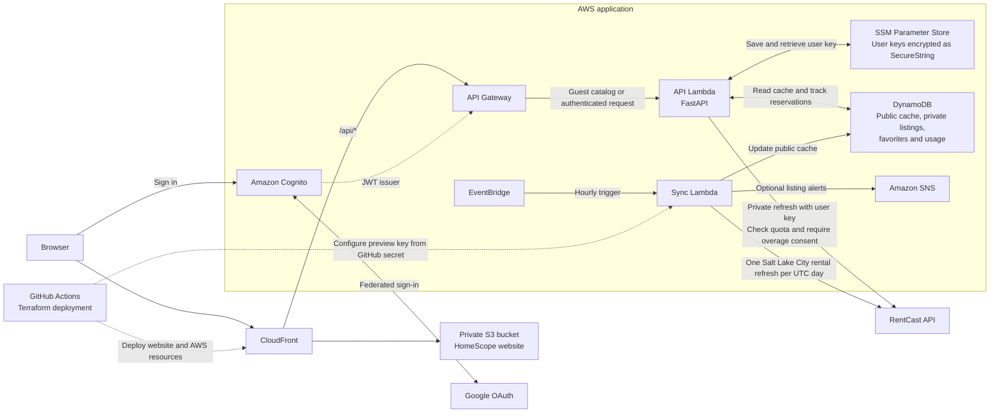

# HomeScope architecture

The public preview and private imports use separate RentCast keys.

- **Guest browsing** reads cached Salt Lake City rentals. The daily import runs at 11:00 UTC.
- **Private refreshes** use the signed-in user's key. HomeScope records request attempts and asks for consent before a potentially billable request.
- **Local development** uses Uvicorn and SQLite. Run `local_run.bat`.
